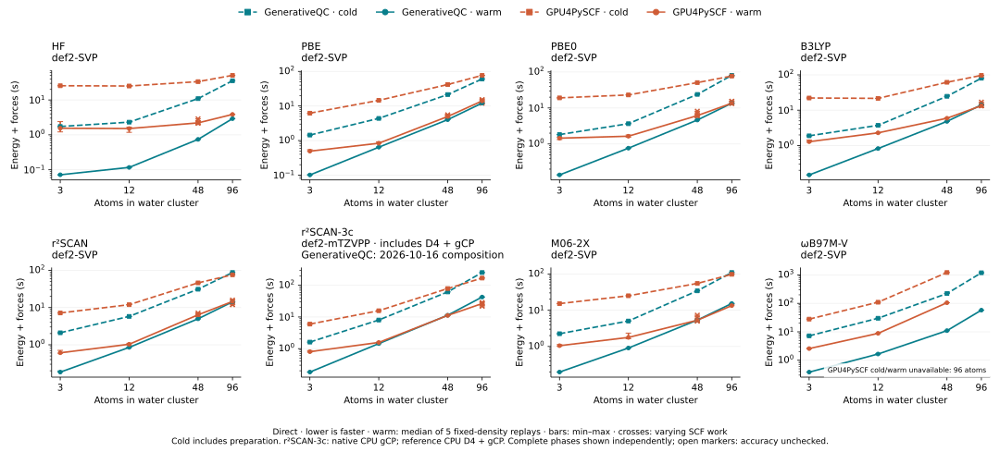
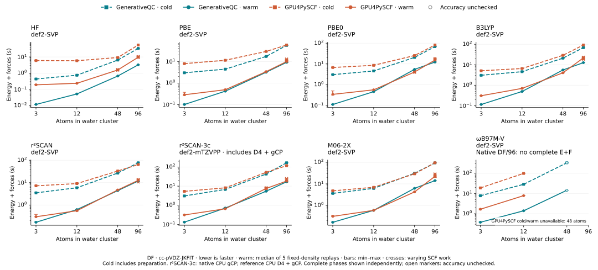
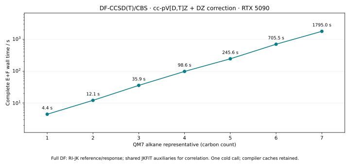

<!--
Keep this README concise and user-facing. Implementation details, capability
boundaries, and benchmark analysis belong in docs/ and benchmarks/results/.
-->

<p align="center">
  <picture>
    <source media="(prefers-color-scheme: dark)" srcset="assets/generativeqc-logo-dark.svg">
    
  </picture>
</p>

<h1 align="center">GenerativeQC</h1>

<p align="center">
  <a href="https://codecov.io/gh/jinzhezenggroup/generativeqc"></a>
</p>

<p align="center">
  <strong>Quantum chemistry generated across the stack.</strong><br>
  GPU-native energies and analytic forces, with reusable batched execution.
</p>

GenerativeQC brings **generation from scientific intent to executable kernels**:
coding agents help develop human-reviewed source; declarative method definitions
and compiler IRs produce execution programs and specialized CPU/CUDA kernels.
The underlying quantum chemistry remains explicit and is checked against
independent scientific references—not replaced by a learned surrogate.

## Highlights

- **HF, DFT, and correlated methods.** RHF/UHF; RKS/UKS from LDA and GGA through
  meta-GGA, hybrid, range-separated, and nonlocal functionals (including PBE,
  PBE0, B3LYP, r2SCAN, WB97M-V, and r2SCAN-3c); qualified MP2, RCCSD, and
  RCCSD(T) paths.
- **Analytic derivatives.** Nuclear forces for qualified CPU/CUDA methods,
  with analytic Hessians and Hessian-vector products in selected domains.
- **GPU-native prepared execution.** Direct and density-fitted paths, reusable
  calculation plans, density warm starts, ragged batches, and per-system isolation.
- **Generated methods and kernels.** MethodIR and Libxc-backed discovery,
  compiler-generated execution/derivative graphs, and AOT-specialized CPU/CUDA
  kernels, with bounded runtime generation where supported.
- **More chemistry.** GFN2-xTB energies and forces; Cartesian and spherical
  Gaussian bases, custom basis input, and scalar Gaussian ECPs.
- **One native core, several interfaces.** Python, C, C++, and a Python-free
  native CLI, plus PyTorch and JAX integration.

## Install

Source builds require CMake 3.24+, a C++20 compiler, and Python 3.10+.
CUDA builds also require a supported CUDA toolkit.

```bash
python -m pip install .
```

For CPU-only installations:

```bash
GENERATIVEQC_ENABLE_CUDA=OFF python -m pip install .
```

For CUDA, select NVCC and an architecture matching your GPU (`120` is an
RTX 5090 example):

```bash
CUDACXX=/path/to/cuda/bin/nvcc \
GENERATIVEQC_CUDA_ARCHITECTURES=120 \
python -m pip install .
```

See the [installation guide](docs/user/installation.md) and
[CUDA/native build guide](docs/developer/build.md) for other architectures,
CMake presets, and SDK installation. The installed native CLI runs without
Python.

## Methods

Explore the compiled method registry and MethodIR compositions:

```bash
generativeqc methods
generativeqc methods --compositions --json
```

DFT selectors include `pbe0-rks` and `pbe0-uks`; the Python API also supports
`r2scan-3c`. Available properties depend on the method and execution context:
check `Calculator.capabilities` or see
[method discovery and support](docs/user/methods.md).

## Python quick start

Coordinates are in Bohr, energies in Hartree, and forces in Hartree/Bohr.
Use `device="cpu"` for CPU-only installations.

```python
from generativeqc import Calculator

calc = Calculator(method="rhf", basis="sto-3g", device="cuda")
result = calc.singlepoint([
    ("H", (0.0, 0.0, -0.7)),
    ("H", (0.0, 0.0, 0.7)),
])

print(result.energy)
print(result.forces)
```

Prepared batches reuse system topology and converged density state:

```python
systems = [
    [("H", (0.0, 0.0, -0.7)), ("H", (0.0, 0.0, 0.7))],
    [("He", (0.0, 0.0, 0.0))],
]

calc = Calculator(method="rhf", basis="sto-3g", device="cuda")
with calc.prepare_batch(systems, warm_start=True) as batch:
    first = batch.execute(strict=True)
    second = batch.execute(strict=True)  # reuses compatible densities

print(first.energies)
```

## Benchmarks

**Complete HF/DFT energy + analytic forces** on RTX 5090 (FP64). GenerativeQC
Direct r²SCAN-3c at 3/12/48/96 atoms uses the qualified 2026-10-16 composition of
#2563, #2567 and the #2558 force stack. All other native points retain the frozen
#2531 + #2532 snapshot; GPU4PySCF timings and independent references are
historical, not rerun. Cold includes setup and the
first E+F call; warm reuses converged density. The water clusters have
3/12/48/96 atoms, using spherical def2-SVP except r²SCAN-3c (def2-mTZVPP).

The figures combine explicitly frozen sources, not a timing claim for the current
checkout. The [r²SCAN-3c update](benchmarks/results/xc-diagonal-potential-20261016/README.md#homepage-update)
records the exact measured composition, accuracy gates and actual SCF work;
the force overlay is not part of #2567. The earlier Direct/96 moved regression
remains rejected (+15.985%).
The [stationary-energy repair](benchmarks/results/r2scan3c-stationary-confirmation-20261016/README.md)
and [integrated-head Direct/48/96 requalification](benchmarks/results/r2scan3c-integrated-acceptance-20261016/README.md)
are retained separately, without relabeling either historical cohort.
Exact-direct and DF pure-J resident defaults start at 544 AOs; see the
[repair decision](.agents/notes/implemented/numerics/2026-10-16-stationary-pure-j-energy-confirmation.md).

**Direct J/K**



**Density fitting (DF)** — cc-pVDZ-JKFIT for both engines.



Native ωB97M-V DF/48 lacks an independent accuracy reference; DF/96 is omitted
(no complete E+F call). Small-system compilation-cache priming is recorded
separately, never subtracted from cold. See the
[updated r²SCAN-3c Direct timings](benchmarks/results/xc-diagonal-potential-20261016/README.md#homepage-update),
[other Direct timings](benchmarks/results/readme-refresh-20261015/timings.md),
[DF timings](benchmarks/results/readme-refresh-20261015/df-timings.md), and
[protocol, accuracy and provenance](benchmarks/results/readme-refresh-20261015/README.md).

**DF-CCSD(T)/CBS energy + analytic forces — QM7 C1–C7**



MP2 correlation is extrapolated with cc-pVDZ/cc-pVTZ; the
DF-CCSD(T)−DF-MP2 correction uses cc-pVDZ. **DF-HF/RI-JK, analytic response and
gradients are fitted consistently**, using JKFIT auxiliaries for both JK and
correlation within each basis group. Timings cover the
complete two-group E+F endpoint, not just SCF or summed component timings.
See the [C1–C7 timing/work table](benchmarks/results/readme-cbs-full-20261014/timings.md)
and [inputs, protocol and limitations](benchmarks/results/readme-cbs-full-20261014/README.md).
The [earlier exact-HF/correlation-only DF series](benchmarks/results/readme-cbs-20261013/README.md)
is retained separately: its fitting model differs, so the two series are not
identical-Hamiltonian speedup measurements.

Other results are in the [benchmark archive](benchmarks/results/README.md).

## Documentation

Start with the [User Guide](docs/user/index.md) or
[Learn quantum chemistry](docs/learn/index.md).
Explore the [Reference](docs/reference/index.md),
[Developer Guide](docs/developer/index.md),
[Maintainer Guide](docs/maintainer/index.md), and
[Agent Guide](docs/agent/index.md).

## License

GenerativeQC is licensed under [GPL-3.0-or-later](LICENSE).
