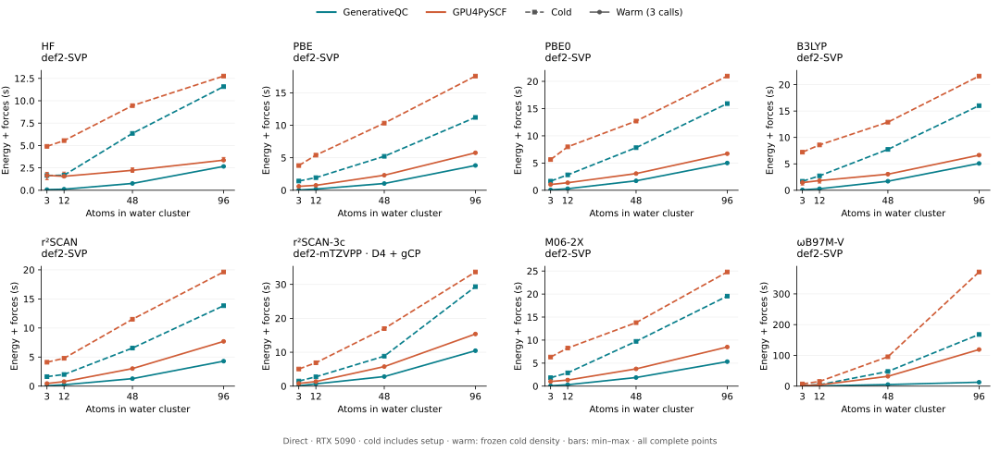
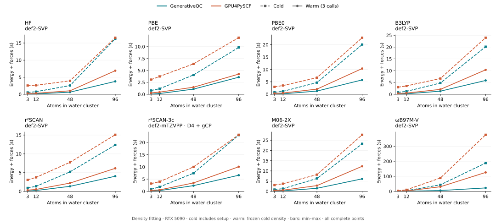
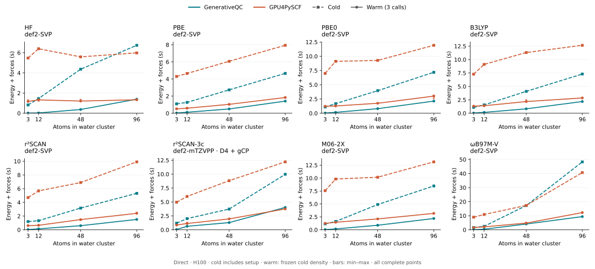
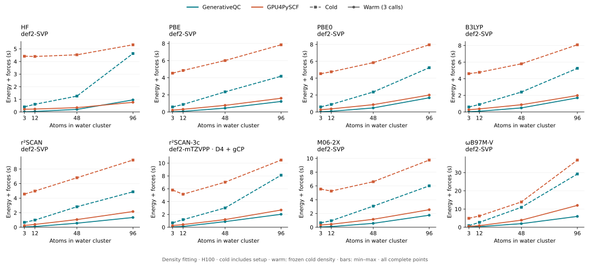
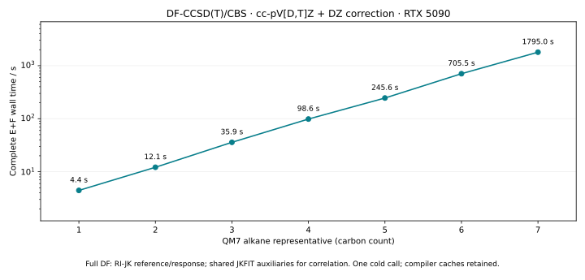

<!--
Keep this README concise and user-facing. Implementation details, capability
boundaries, and benchmark analysis belong in docs/ and benchmarks/results/.
-->

<p align="center">
  <picture>
    <source media="(prefers-color-scheme: dark)" srcset="assets/generativeqc-logo-dark.svg">
    
  </picture>
</p>

<h1 align="center">GenerativeQC</h1>

<p align="center">
  <a href="https://codecov.io/gh/jinzhezenggroup/generativeqc"></a>
</p>

<p align="center">
  <strong>Quantum chemistry generated across the stack.</strong><br>
  GPU-native energies and analytic forces, with reusable batched execution.
</p>

GenerativeQC brings **generation from scientific intent to executable kernels**:
coding agents help develop human-reviewed source; declarative method definitions
and compiler IRs produce execution programs and specialized CPU/CUDA kernels.
The underlying quantum chemistry remains explicit and is checked against
independent scientific references—not replaced by a learned surrogate.

## Highlights

- **HF, DFT, and correlated methods.** RHF/UHF; RKS/UKS from LDA and GGA through
  meta-GGA, hybrid, range-separated, and nonlocal functionals (including PBE,
  PBE0, B3LYP, r2SCAN, WB97M-V, and r2SCAN-3c); qualified MP2, RCCSD, and
  RCCSD(T) paths.
- **Analytic derivatives.** Nuclear forces for qualified CPU/CUDA methods,
  with analytic Hessians and Hessian-vector products in selected domains.
- **GPU-native prepared execution.** Direct and density-fitted paths, reusable
  calculation plans, density warm starts, ragged batches, and per-system isolation.
- **Generated methods and kernels.** MethodIR and Libxc-backed discovery,
  compiler-generated execution/derivative graphs, and AOT-specialized CPU/CUDA
  kernels, with bounded runtime generation where supported.
- **More chemistry.** GFN2-xTB energies and forces; Cartesian and spherical
  Gaussian bases, custom basis input, and scalar Gaussian ECPs.
- **One native core, several interfaces.** Python, C, C++, and a Python-free
  native CLI, plus PyTorch integration and an experimental differentiable Array API.

## Install

Source builds require CMake 3.24+, a C++20 compiler, and Python 3.10+.
CUDA builds also require a supported CUDA toolkit.

From the repository root (see the [installation guide](docs/user/installation.md)
for obtaining the source and setting up an environment):

```bash
python -m pip install .
```

For CPU-only installations:

```bash
GENERATIVEQC_ENABLE_CUDA=OFF python -m pip install .
```

For CUDA, select NVCC and an architecture matching your GPU (`120` is an
RTX 5090 example):

```bash
CUDACXX=/path/to/cuda/bin/nvcc \
GENERATIVEQC_CUDA_ARCHITECTURES=120 \
python -m pip install .
```

See the [installation guide](docs/user/installation.md) and
[CUDA/native build guide](docs/developer/build.md) for other architectures,
CMake presets, and SDK installation. The installed native CLI runs without
Python.

## Methods

Explore the compiled method registry and MethodIR compositions:

```bash
generativeqc methods
generativeqc methods --compositions --json
```

DFT selectors include `pbe0-rks` and `pbe0-uks`; the Python API also supports
`r2scan-3c`. Available properties depend on the method and execution context:
check `Calculator.capabilities` or see
[method discovery and support](docs/user/methods.md).

## Python quick start

Coordinates are in Bohr, energies in Hartree, and forces in Hartree/Bohr.
Use `device="cpu"` for CPU-only installations.

```python
from generativeqc import Calculator

calc = Calculator(method="rhf", basis="sto-3g", device="cuda")
result = calc.singlepoint([
    ("H", (0.0, 0.0, -0.7)),
    ("H", (0.0, 0.0, 0.7)),
], properties=("energy", "forces"))

print(result.energy)
print(result.forces)
```

For energy-only requests, use `properties=("energy",)`; `result.forces` is then
`None`. The [quick start](docs/user/quickstart.md) explains input units, charge,
spin and failure behavior.

Prepared batches reuse system topology and converged density state:

```python
systems = [
    [("H", (0.0, 0.0, -0.7)), ("H", (0.0, 0.0, 0.7))],
    [("He", (0.0, 0.0, 0.0))],
]

calc = Calculator(method="rhf", basis="sto-3g", device="cuda")
with calc.prepare_batch(systems, warm_start=True) as batch:
    first = batch.execute(strict=True)
    second = batch.execute(strict=True)  # reuses compatible densities

print(first.energies)
```

## Benchmarks

**HF/DFT energy + analytic forces — RTX 5090 (2026-11-11)**

Fresh measurements of master `4024f95b8` plus exact nuclear-derivative and
overlap-preparation optimizations, on an exclusive node with unchanged
GPU4PySCF settings, show GenerativeQC faster in **64/64 cold**
and **64/64 warm** cases. For 96-atom Direct ωB97M-V, warm speedup is **9.42×**.
The Standard benchmark uses the public default policy, initial guess, grids and
solver/scheduling controls without benchmark-only overrides.





The source-matched Release build uses default XC/VV10 grids, native SCF policies
and full grid-response forces. Cold includes setup; warm is the median of three
frozen-density calls, with min–max bars. These are single-process observations,
not statistical rankings. Independent accuracy gates qualify **58/64 pairs**:
**58/58 cold** and **58/58 warm** are faster. The six failing pairs remain plotted
(DF HF at all sizes; Direct/DF M06-2X at 3 atoms).
See [measurements, accuracy and conditions](benchmarks/results/readme-rtx5090-composed-20261111/README.md)
for all 512 endpoints, the default convergence contract and reproducible
timing/error summaries and exact source/image identities. Cold DF HF96 now takes
**16.259 s versus 16.559 s**; six separate balanced-order repeats also favor
GenerativeQC. Matching SCF thresholds still does not imply identical work or a
universal speedup guarantee.

**HF/DFT energy + analytic forces — H100 (2026-11-12)**

The same 64 pairs on master `a7241b4fd` (after #3072) on one H100 80GB,
against GPU4PySCF 1.9.0 defaults, show GenerativeQC faster in **62/64 cold**
and **61/64 warm** cases. Independent gates qualify **58/64 pairs**, with the
same six failures; **56/58 cold** and **56/58 warm** qualified pairs are faster.
**H100 is not ahead everywhere:** qualified slow points are Direct HF96
(cold 6.74 vs 5.99 s, warm 1.40 vs 1.33 s), Direct ωB97M-V96 cold
(48.3 vs 40.7 s) and Direct r2SCAN-3c96 warm (4.02 vs 3.75 s).





See [H100 measurements, accuracy and conditions](benchmarks/results/readme-h100-20261112/README.md).

**DF-CCSD(T)/CBS energy + analytic forces — RTX 5090**



MP2 correlation is extrapolated with cc-pVDZ/cc-pVTZ; the
DF-CCSD(T)−DF-MP2 correction uses cc-pVDZ. **DF-HF/RI-JK, analytic response and
gradients are fitted consistently**, with matching JKFIT auxiliaries and all
electrons. The curve covers C1–C7; each point is the median of two fresh complete
energy+force calls. Process/CUDA startup is retained separately. Basis snapshots
are outside timing.

The [measurements, work counts and independent validation](benchmarks/results/cbs-routine-standard-20261025/README.md)
retain every sample, source identity and failed candidate. Validation covers
13 physical-basis populations, full Cartesian forces and relative energies.

Other results are in the [benchmark archive](benchmarks/results/README.md).

## Documentation

Start with the [User Guide](docs/user/index.md) or
[Learn quantum chemistry](docs/learn/index.md).
Explore the [Reference](docs/reference/index.md),
[Developer Guide](docs/developer/index.md),
[Maintainer Guide](docs/maintainer/index.md), and
[Agent Guide](docs/agent/index.md).

## License

GenerativeQC is licensed under [GPL-3.0-or-later](LICENSE).
