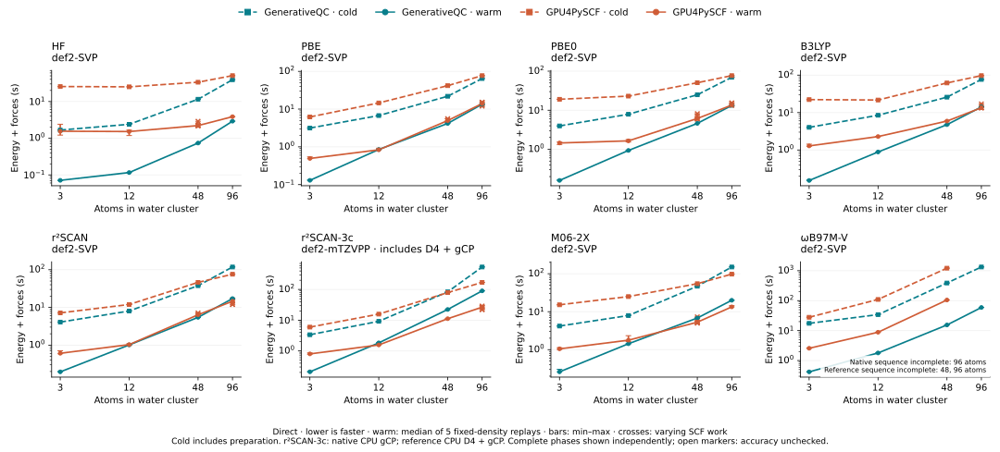
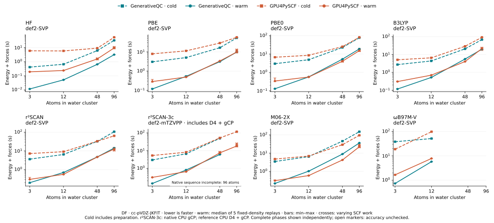

# HF and DFT energy and analytic forces: benchmark issue follow-up

This publication builds on PR #2401 and adds source-matched measurements for
issues #2411–#2418, #2421 and #2426. Each point retains its own source revision,
native build identity, library hash, consumer hashes and Slurm receipt. The
current figures combine qualified new points with unchanged older observations;
they are not a complete remeasurement of one source revision.





The [direct](timings.md) and [DF](df-timings.md) tables retain cold, warm, moved
and moved-warm timings and SCF work. Warm means the median of all five frozen-seed
replays, with the entire minimum–maximum range. Unchecked phases use open markers;
failed or incomplete phases have no successful timing. No timeout was increased.

## Confirmed improvements

| Issue | Actual qualification and result |
| --- | --- |
| [#2411](https://github.com/jinzhezenggroup/generativeqc/issues/2411) | #2425's integrated pure-Coulomb DF repair passes all 12 calls at 48/96 atoms for PBE and r²SCAN. PBE/96 cold: 1225.048 → 53.891 s; r²SCAN/96: 1221.951 → 106.578 s. New warm medians: 9.884 / 14.213 s. |
| [#2412](https://github.com/jinzhezenggroup/generativeqc/issues/2412) | Integrated B3LYP DF force repair passes all 12 calls at 3, 12, 48 and 96 atoms; independent final-state/lifetime tests also pass. |
| [#2413](https://github.com/jinzhezenggroup/generativeqc/issues/2413) | WB97M-V DF passes all 12 calls at 3 and 12 atoms with the matching independent full-range-DF/exact-long-range-K oracle. The old default-reference mismatch remains in historical probes. Large WB endpoints remain unresolved. |
| [#2414](https://github.com/jinzhezenggroup/generativeqc/issues/2414) | [#2438](https://github.com/jinzhezenggroup/generativeqc/pull/2438) qualifies M06-2X FP64 local AO execution. Direct and DF pass all 12 independent calls at 3/12/48/96 atoms. DF/96 cold: 628.378 → 150.082 s; warm: 116.061 → 36.357 s. The older timeout remains retained. |
| [#2415](https://github.com/jinzhezenggroup/generativeqc/issues/2415) | [#2443](https://github.com/jinzhezenggroup/generativeqc/pull/2443) removes the DF resident/streamed crossover on geometry rebuilds. Canonical r²SCAN-3c DF passes all 12 calls at 3/12/48/96 atoms, including D4/gCP. DF/96 cold/warm/moved/moved-warm: 226.247 / 23.080 / 145.915 / 23.085 s; the prior cold and moved timeouts remain retained. |
| [#2416](https://github.com/jinzhezenggroup/generativeqc/issues/2416) | [#2446](https://github.com/jinzhezenggroup/generativeqc/pull/2446) forwards pure-J force demand; [#2450](https://github.com/jinzhezenggroup/generativeqc/pull/2450) admits the existing spatial schedule automatically. Direct r²SCAN-3c now completes all 12 calls at 3/12/48/96 atoms under the original limits. At 96 atoms: cold 538.312 s, warm 90.092 s, moved 268.003 s, moved-warm 90.203 s. Prior final-replay timeouts remain retained. |
| [#2418](https://github.com/jinzhezenggroup/generativeqc/issues/2418) | [#2436](https://github.com/jinzhezenggroup/generativeqc/pull/2436) packages exact M06-2X stationary AOT plans. Source `61b9387f3` gives 3-atom direct cold 4.378 s versus historical 229.691 s. A separate empty artifact-cache run passes all 12 calls with runtime compiler discovery and invocation forbidden. Later source-matched populations remain separately identified. |
| [#2421](https://github.com/jinzhezenggroup/generativeqc/issues/2421) | [#2437](https://github.com/jinzhezenggroup/generativeqc/pull/2437) adds automatic HF/DF value-response planning and exact-state final occupied projection reuse. All 12 calls pass at 96 atoms. Warm: 59.318 → 3.201 s; new cold 32.994 s, moved 28.670 s. |

Direct WB97M-V passes all 12 calls at 48 atoms within 1800 s with
[#2454](https://github.com/jinzhezenggroup/generativeqc/pull/2454), automatic exact
force reuse [#2462](https://github.com/jinzhezenggroup/generativeqc/pull/2462),
automatic exact SCF reuse [#2467](https://github.com/jinzhezenggroup/generativeqc/pull/2467),
the composite phased-Becke budget repair
[#2468](https://github.com/jinzhezenggroup/generativeqc/pull/2468), and default bounded
native frozen-VV10 initialization, followed by bounded automatic range values
and audited warm reuse [#2490](https://github.com/jinzhezenggroup/generativeqc/pull/2490).
Cold/warm/moved/moved-warm are now
253.595 / 11.406 / 212.176 / 11.392 s, compared with
388.993 / 15.453 / 290.381 / 15.559 s before range reuse and
575.813 / 15.548 / 405.620 / 15.580 s before initialization. The warm median moves from 67.707 s
(bilateral source) to 39.029 s (force reuse), 18.435 s (SCF reuse), then 15.548 s
(correctly budgeted Becke); all superseded complete populations remain retained.
Maximum current 48-atom energy/force errors are 4.093e-12 Eh / 1.798e-11 Eh/Bohr.
Every frozen replay records zero SCF and force VV10 pair sweeps, while physical
Focks and remaining work still run. Both geometry owners allocate 41,706,304
phased bytes and actually visit all 1,179,648 points in 1,152 phase batches.
The preceding source had zero phased bytes/batches despite requesting the path.

The latest default round passes all 36 calls at 3/12/48 atoms. The figure uses
this one round at all three sizes: 3-atom cold/warm/moved/moved-warm are
7.059 / 0.387 / 5.341 / 0.386 s, and 12-atom values are
30.388 / 1.651 / 19.602 / 1.668 s. Earlier startup/cache controls and all
superseded populations remain in the receipts. The bounded native initializer,
full screened range values within a 4 GiB optional ceiling, and audited same-geometry
range replay are automatic in this measured source. Incremental J/K, range freezing,
DIIS continuation, inexact inner solves, outer secant, target-DIIS tail,
longer delta chains and explicit device-final-validation are absent.
All provisional and target Focks share the original 100-iteration budget, and
only consecutive physical target states can satisfy the unchanged gates.

At 96 atoms, default cold completes in 1332.267 s and all five warm calls
complete with median 59.321 s. All six returned E/F records pass the independent
gates (maximum errors 6.821e-12 Eh / 2.342e-11 Eh/Bohr). The whole sequence
times out in moved/0 at the original 1800 s limit. Its complete cold/warm phases
are plotted with the sequence explicitly marked incomplete; no moved timing or
full-population acceptance is inferred. The 96-atom endpoint and #2426 remain
unresolved.

Default-off initializer trials are retained separately: one 96-atom cold returns
in 1562.126 s, and its revised inner solve regresses to 1629.527 s. Both hit the
original 1800-second whole-point limit during warm replays. The revised 48-atom
initializer completes in 411.440 / 18.234 / 313.692 / 18.256 s, but it is not a
default result. Freezing range exchange as well increases small-system iteration
counts and is not promoted. Its original null gates remain unchanged; an offline
comparison with the identical independent protocol is retained separately.
Later incremental initialization and bounded eight-delta experiments complete
96-atom cold in 1328.238 / 1352.005 s and all five warm calls, but both time out
in moved/0. The longer chain yields little complete 48-atom improvement and is
not promoted. Unshifted and approximately rebased inner DIIS do not reduce the
small-system iteration count and are also not promoted. All partial trials,
negative results and source identities remain separate from default curves.

The [range follow-up](../vv10-range-followups-20261014/README.md) retains every
new finalized trial, including complete force vectors and independent references.
The first 2 GiB automatic candidate refused the 3.61 GB 48-atom inventory and
remained near 388/15.48/290/15.46 s. The corrected 4 GiB candidate above is a
fresh no-experiment-switch population. The 96-atom partial-cache/replay,
inexact-inner and outer-secant trials still time out in moved/0 after six passing
calls; their cold times are 1018.641, 947.696 and 1056.500 s. A target-DIIS tail
increases pair sweeps from four to six on small controls and is not advanced to
a large timing population. The expanded range mask `0xffffbfc` also times out at moved/0 (cold 950.947 s; all-five warm median 49.353 s), without force-memory eviction. None of these experiments replaces the default 96 point.

These are before/after complete endpoint observations, not isolated attribution
of every source change. The newer integration uses the current native public
initialization policy, including Huckel; historical initialization and work
counts are preserved. M06-2X API-cold timing includes package loading. Its
separate compiler-forbidden control establishes AOT use, not a reconstruction
of the historical compiler-cache state.

The current reductions contain 31 fully qualified direct points (372 calls)
and 30 fully qualified DF points (360 calls). Maximum accepted errors are
3.275e-11 / 2.201e-10 for direct and 2.261e-10 / 1.573e-10 for DF, in Eh and
Eh/Bohr respectively. All pass the unchanged 1e-8 Eh / 1e-7 Eh/Bohr gates.

## Remaining qualification

- #2416's ordinary-resource population is qualified on source `aaec57399`.
  PBE/r²SCAN 48/96 controls also complete all 12 calls. Initial small controls
  exposed a separate resource-dependent force refusal, reproduced with 8 GiB
  free: the optional shell stack lease was unavailable after successful SCF.
  [#2451](https://github.com/jinzhezenggroup/generativeqc/pull/2451) preserves the
  existing canonical GPU force fallback and passes independent Libcint checks
  plus a complete 12-atom pressure population. Pressure runs and diagnostic
  error-detail wrappers are excluded from the plotted timings; their failures
  and successes remain in `followup-receipts.json.xz`.
- #2415 is now qualified at 96 atoms on source `3660e04d2`. Source `227c55c06`
  timed out in cold SCF; the intermediate `fedf81b83` completed cold and five
  warm calls but timed out after geometry movement. Both failures remain in
  the summaries. The final automatic singleton pure-J policy uses disjoint
  setup/SCF workspace lifetimes and may increase the generic fractional
  allowance by the minimum needed to retain fitted values. Observed free
  memory, absolute headroom, explicit caller caps and solver workspace bounds
  remain enforced. Cold and moved both report non-streamed fitted values.
- #2417 and #2426: WB97M-V reference timing populations remain incomplete at
  48/96 atoms; native now completes the independently checked 48-atom population.
  A separately reconverged moved-geometry oracle supplies accuracy only and
  never adds a reference timing sample. The preceding correct native candidate
  `99e7c54b2` still timed out during its last moved-warm call; the earlier
  `de4d7f564` trial was explicitly stopped after its admission failure was
  diagnosed, rather than relabelled as a timeout. Both remain retained.
  Diagnostic reference/48 has approximately 820 billion active ordered pairs
  and about 23 s per VV10 feature call. Native/96's first measured SCF stage
  takes 116.0 s in nonlocal pairs versus 4.24 s in semilocal density/features
  and 2.45 s in nonlocal AO potential assembly on the older source. A 180-second
  trace of `7001858f1` measures an 82.6 s bilateral pair call; this short trace
  is not a formal 1800-second outcome. A subsequent formal run on that source
  (Slurm 8241) reaches the unchanged 1800-second whole-point limit in cold/0,
  with no completed native E/F records. Independent 96-atom cold and moved
  oracles have separately converged in 4617.1 / 4578.2 s (45 iterations each),
  with complete finite E/F and retained residuals. Both start from independent
  atomic guesses. Their diagnostic durations are excluded from reference timing
  populations and speedups. These accuracy-only receipts provide the alternative
  oracle allowed by #2417; they do not resolve the reference timing population
  or native/96 performance. Original and new time limits stay visible.
- The superseded M06-2X/DF 96-atom timeout and an earlier slower 48-atom
  population remain in the summaries. A same-source 48-atom replay already
  reduced cold/warm to 102.832/12.012 s before the local-AO change; this variation
  is not attributed to that change. Source `9e3c5e6e6` subsequently gives
  45.783/8.920 s at 48 atoms and a complete passing 96-atom population.
- A private fully FP64 reciprocal refinement saves only 8.3% in synthetic VV10
  features and 5.8% in geometry. This is insufficient endpoint evidence; the
  original production arithmetic is retained.

## Scientific and timing boundaries


- Nested water clusters: 3, 12, 48 and 96 atoms, batch size one, restricted FP64
  calculations. All methods use full def2-SVP spherical shells (24 AOs per water)
  except r2SCAN-3c, whose defining def2-mTZVPP basis has 34 AOs per water.
- Both engines use the same explicit 48×16×32 per-atom moving quadrature, three
  original-Becke partition iterations, no radius adjustment and analytic grid
  response. This is a matched-grid comparison, not a claim about each package's
  default grid or chemical grid-convergence accuracy.
- The public native endpoint and GPU4PySCF both include SCF energy, analytic
  forces, synchronization and force return to the host. No native calculation
  uses a reference density or reference energy/force implementation.
- Cold includes calculator/engine construction, preparation and the first
  endpoint. Process startup, provenance collection and input snapshot loading
  are excluded. Existing compiler/artifact caches are retained; these are API
  cold starts, not empty-cache compilation or process-launch timings.
- Each warm series reuses one frozen engine-local post-cold density. The moved
  geometry displaces the first hydrogen by 0.001 Bohr along z; its own post-move
  density is frozen for the five moved replays. Densities are not progressively
  improved across measured repeats.
- Native tolerances are 1e-12 Eh for energy, 1e-10 for density and 1e-12 for
  screening, with 100 SCF iterations maximum. GPU4PySCF uses 1e-12 Eh energy,
  1e-10 orbital gradient and 1e-14 direct-integral screening tolerances. Its stock
  DIIS is unchanged. Full-density potential rebuilds suppress both incremental
  inputs, as in the existing PBE0 protocol, and their work stays timed.
- r2SCAN-3c includes D4 (`s6=1`, `s8=0`, `s9=2`, `a1=0.42`, `a2=5.65`,
  `ga=2`, `gc=1`) and gCP. Its reference combines GPU4PySCF electronic calculations
  with CPU dftd4 4.3.0 and the independent CPU gCP qualification provider. Both
  corrections and their geometry-dependent setup are evaluated inside **every**
  reference endpoint. The native endpoint uses CUDA D4 and native CPU gCP; its
  corrections also remain inside every timed endpoint. The figure labels the
  reference CPU corrections.
- WB97M-V includes self-consistent VV10 and the shared molecular density-screening
  policy. Direct and DF use separate, matching independent oracles. No mixed
  precision, experimental AO selection or preliminary-density override is enabled.


## Provenance, validation and retention

Benchmark GPU work uses finite Slurm allocations on n1/node1, n4/node4 or
n5/node5, partition main, RTX 5090 and eight CPU threads, with assigned device
visibility preserved. Later independent PR qualifications also use n2/node2's
RTX PRO 6000; those test durations are not RTX 5090 benchmark observations.
The reference stack is GPU4PySCF 1.8.1, PySCF 2.14.0, CuPy 13.6.0 and
CUDA 12.9. Core/AOT builds are Release sm_120 and use verified ccache;
runtime JIT retains the verified sccache cache where needed.

The integrated repair campaign is bound to `b27ee33a2`; HF/map/AOT qualification
is bound to `61b9387f3`; the first dense-grid controls use `877775209`;
final feature-grid populations use `227c55c06`; M06-2X local-AO populations use
`9e3c5e6e6`. The frozen sources are available on the
[qualification source branch](https://github.com/jinzhezenggroup/generativeqc/tree/codex/benchmark-qualified-source-20261013).
DF setup lifetime trials use `fedf81b83`; final DF geometry-rebuild qualification
uses `3660e04d2`, retained on the
[DF qualification source branch](https://github.com/jinzhezenggroup/generativeqc/tree/codex/benchmark-df-qualified-source-20261013).
Pure-J spatial populations use `aaec57399`; bilateral VV10 populations use
`7001858f1` with library SHA256
`08b866dc5404feebf024011fe95a9e04b16ba55256078874d4fcda080e21fdd0`.
Both are ancestors of the frozen
[VV10 qualification source](https://github.com/jinzhezenggroup/generativeqc/tree/codex/benchmark-vv10-qualified-source-20261014).
Automatic exact force reuse is qualified on `9aabd59a3` with library SHA256
`4c7b6ace6f07466af7967c0cc1f4453a7ff09a03c0ebcf13316527105e6779c7`, retained on
[its frozen source branch](https://github.com/jinzhezenggroup/generativeqc/tree/codex/benchmark-vv10-automatic-source-20261014).
Automatic SCF reuse is qualified on `3b15b73d7`, and the preceding phased-budget
round uses `948fb1058` with library SHA256
`4a5ccdabd0a3c67eeab53281a52ae4d0c556e364f9e421d0d29b1f2f16fb5e39`.
Both, and the separately labeled initializer trials, are retained in
[the frozen source ancestry](https://github.com/jinzhezenggroup/generativeqc/tree/codex/benchmark-vv10-scf-phased-source-20261014).
The retained prior default initializer populations use `22ff59fd3`, library SHA256
`242be46485a289310f0034feb5ff3f8532f8993e8f22961194f15c7f703becb3`, retained on
[the frozen initializer source branch](https://github.com/jinzhezenggroup/generativeqc/tree/codex/benchmark-vv10-default-initializer-source-20261014).
That source passes 28 receipt/budget/replay and independent molecular E/F
checks; 22 receipt/budget/replay cases also pass both memcheck and synccheck
with zero errors. These checks use finite n4 Slurm allocations and cover the
default policy and explicit alternate/failure paths. A separate intrusive n1
short-iteration trace counts six actual Fock evaluations across a failed-seed
retry, including four VV10 sweeps averaging 81.964 s; the configured
three-iteration limit is per attempt. Its 470.728 s execution is diagnostic
only and never a benchmark sample.
The independently assembled [initialization PR #2480](https://github.com/jinzhezenggroup/generativeqc/pull/2480)
is qualified at `e0def8fff`: 15 host checks pass; n4 job 875 passes 13 mixed
receipt/budget/replay checks and six independent molecular energy/force and
reconverged energy-difference checks. Jobs 876/877 each pass 13 cases under
memcheck/synccheck, with zero errors. Its library hash, 1724-input native source
audit, scheduler receipts and exact logs are retained in the follow-up receipts.
The PR branches can differ from these assembled snapshots; only the recorded
snapshot identities identify a measured population.
The current 3/12/48 default populations use `fa291a6f2151202c84b25034af9db9604a4543a2`,
library SHA256 `b4342d8389ab5dbc32291b54a82aee884c1e008a07090fc6d2d1ce5de8ee89b3`,
retained on [the frozen range source](https://github.com/jinzhezenggroup/generativeqc/tree/codex/benchmark-vv10-range-four-gib-source-20261014).
The 1724-input native audit and all 44 recorded consumer hashes match that Git
source. n4 Slurm 909 passes 23 range/replay/refusal and independent molecular
E/F/reconverged energy-difference cases, followed by all 36 original-protocol
benchmark calls. The [separate range receipts](../vv10-range-followups-20261014/manifest.json)
also distinguish synchronized PR-stack qualification at `8c3752791` from its
historical parent snapshots. The default 96 observation remains at `22ff59fd3`.
Earlier explicit opt-in populations use `129d1fa3c` and remain in the receipts.
Full revisions, source inventories, library hashes and
individual raw-file identities are in [manifest.json](manifest.json) and both
compressed summaries. Later source changes do not relabel these measurements.
The source audit reconstructs each native source inventory and verifies all
recorded consumer files (43 or 44, as recorded for each frozen revision).
Host integration tests and
independent CUDA tests qualify the changes; intrusive
profilers, setup failures and compiler-forbidden controls stay outside clean
benchmark populations.

[followup-prior.json.xz](followup-prior.json.xz) losslessly retains #2401's prior
summaries, manifest and report, including failed probes, timeouts and all scalar
observations. The old unqualified DF probes also remain in the current DF summary
as historical observations. [source-campaigns.json.xz](source-campaigns.json.xz),
[force-memory.json.xz](force-memory.json.xz) and the
[reference replay audit](reference-replay-audit.json) retain earlier evidence.
[followup-receipts.json.xz](followup-receipts.json.xz) retains authentic test
receipts, the compiler-forbidden control, source audits, the DF geometry-rebuild
diagnosis and the rejected reciprocal probe. Failed fixtures and missing-library setup attempts remain
labelled as failures, rather than being rewritten as final acceptance. Native
arrays, build products and full trial logs stay in ignored local storage.

The optional small-grid regression attempts retain real absolute-reference
failures: coarse sto-3g water-48 differs by about 9.883e-7 Eh on both unphased
and phased sources, and two hydrogen-cluster grids differ by 1.353e-8 and
1.017e-8 Eh. They are not accepted E/F fixtures. The unchanged original-grid
water-48 population and two-step reconverged energy derivatives qualify the
budget repair; neither the benchmark grid nor acceptance gate was relaxed.

## Reproduction

Use a source-matched Release native library and all stationary AOT libraries
**and their JSON manifests**. Run each campaign in a fresh directory. Preserve
independent reference JSON before launching native measurements. Set
`README_BENCHMARK_METHODS`, `README_BENCHMARK_SIZES` and
`README_BENCHMARK_DENSITY_FITTING` (`none` or `cuda`) as needed; the default point
limit is 1800 seconds and five replays per warm phase.

```bash
srun --partition=main --gres=gpu:5090:1 --nodes=1 --ntasks=1 \
  --cpus-per-task=8 --time=00:35:00 \
  bash benchmarks/run_readme_dft_benchmarks.sh both
PYTHONPATH=.:python python -m tools.render_readme_dft \
  --summary benchmarks/results/readme-dft-20261013/summary.json.xz \
  --output .artifacts/readme-figure
PYTHONPATH=.:python python -m tools.render_readme_dft \
  --summary benchmarks/results/readme-dft-20261013/df-summary.json.xz \
  --output .artifacts/readme-figure
```

Both engines can run independently (`reference` or `native`). The separately
reviewed [accuracy-oracle driver](https://github.com/jinzhezenggroup/generativeqc/pull/2449)
can validate a missing geometry using an independent atomic-guess solve, exact
protocol/basis identity and strict convergence residuals. The original
48-atom one-off driver's exact bytes and SHA remain in the receipts, separately
from the maintained driver used for 96 atoms. Missing reference
geometries remain unchecked. A later oracle never rewrites original null gates.
Complete independently checked 12-call populations replace historical points.
A newer incomplete population can add complete checked phases where no complete
population exists, with its timeout and partial rows retained. All old outcomes
remain recoverable; no incomplete warm series is reduced to a successful median.

The complete follow-up source inventories are stored losslessly in [source-audit.json.xz](source-audit.json.xz), with stored and uncompressed hashes in the manifest. This storage compaction preserves every provenance field and all samples.
