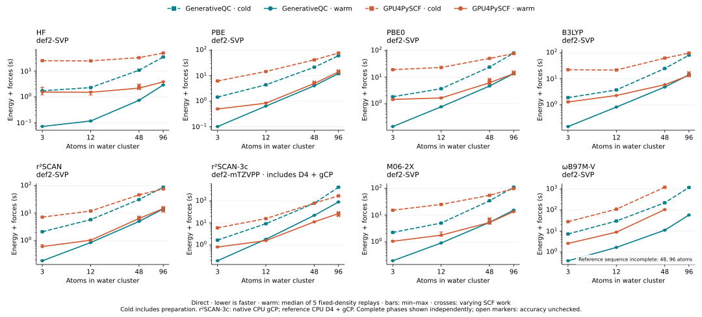

# HF/DFT README benchmark refresh (2026-10-15)

This campaign replaces the native HF and seven DFT series in both README
Direct/DF panels. **GPU4PySCF was not rerun**: its historical timings, SCF
work, failures and independent reference arrays remain unchanged.
DF-CCSD(T)/CBS is unaffected.

## Results and limits

- **63 complete native populations, 756 energy + analytic-force calls:** 744
  pass independent `1e-8 Eh` energy and `1e-7 Eh/bohr` force gates.
  The 12 ωB97M-V DF/48 calls are explicitly **unchecked** (no matching oracle);
  DF/96 is omitted because no complete native E+F call was obtained.
- Maximum checked differences: `2.2555e-10 Eh` in energy and
  `1.6854e-10 Eh/bohr` in force. Another 384 small-system cache-priming
  calls are recorded separately, not included in timing populations.
- These are absolute endpoint timings, **not** a balanced before/after
  performance experiment. Differing SCF work and cache readiness are not
  normalized away; neither an individual kernel gain nor a universal speedup
  is implied.




Full [Direct timing/work table](timings.md) and
[DF timing/work table](df-timings.md).

## Frozen source

| Input | Revision |
| --- | --- |
| #2531 (Direct-J / strict-FP64 XC correction) | `ba0dadbdcdef7af18715b72a2366595719df4bde` |
| #2532 (resident final validation for pure-J KS) | `27d3b8558b7db2ae4b7d4051ae9122522379a809` |
| Combined measurement commit | `1593d3b2fea9ed3e9232efc49eedede1beb1787b` |
| Combined source tree | `f158f1c1b69700df6d74b0ebe42c68d370be09f3` |

The combined source includes master `890c425b0` and can be reconstructed
using `git merge-tree --write-tree 27d3b8558 ba0dadbdc` after fetching
those commits. The PRs later advanced to `01ed327f4` and `1be47f590`;
[source-input-audit.json](source-input-audit.json) verifies that these
test/publication-only changes alter no measured native input or benchmark
consumer. Measurements retain the original frozen identity, not the later
PR heads or current master. The historical #2532 `none/96/moved`
nonregression failure remains an acceptance hold; this refresh does not
turn that gate into a pass.

## Measurement protocol

- **Hardware/build:** Slurm-assigned RTX 5090 GPUs (n1/n4/n5), finite
  allocations; CUDA 12.9.1, Release/sm_120, source-matched native core and
  all 24 stationary-force AOT plugins. Compiler-cache and exact binary
  identities are retained in [build-settings.json](build-settings.json);
  all 16 allocations, assigned devices and log hashes are retained in
  `job-receipts.json.xz`.
- **Cases:** 3/12/48/96-atom water clusters, spherical def2-SVP except
  r²SCAN-3c (def2-mTZVPP); both DF engines use cc-pVDZ-JKFIT.
  The moving, unpruned `(48, 16, 32)` Becke grid, FP64,
  public initialization and convergence thresholds are unchanged.
- **Per population:** one cold, five fixed-density warm, one moved-geometry
  and five moved-warm complete E+F calls. Cold includes Calculator creation,
  preparation and first execution. Warm results report five-sample medians
  and ranges; recorded SCF iterations/Fock builds are not normalized away.
- **Cache and accuracy:** 3/12-atom priming runs in separate processes;
  measurement Calculators, densities and checkpoints are fresh. Priming is
  never subtracted from cold. Native accuracy uses retained independent
  energy/force arrays, never GPU4PySCF or a reference density in production.

## Evidence and reproduction

`manifest.json` records checksums for publication files and four unchanged
historical reductions. Four superseded SVGs are preserved losslessly as
`.svg.xz` with verified original expanded hashes, under the 64 MiB cap.
`native-summary.json.xz` contains native timings, work counts, acceptance
residuals and provenance; `job-receipts.json.xz` contains GPU/Slurm receipts.
Large raw arrays, SCF histories and build logs remain in ignored campaign
storage; offline replay validates retained scalars and identities, **not**
omitted raw vectors.

From the repository root, replay the figures and tables without a GPU or a
reference-engine calculation:

```bash
PYTHONPATH=.:python python benchmarks/results/readme-refresh-20261015/refresh.py
PYTHONPATH=.:python python benchmarks/results/readme-refresh-20261015/refresh.py \
  --output .artifacts/readme-refresh-replay
```

Replay requires Matplotlib, Scour and defusedxml. For raw-data reduction,
use `reduce.py --raw <campaign-directory>`; `restore_references.py`
reconstructs accuracy receipts from retained independent arrays.
`reproduce.sh <method> <none|cuda>` runs native-only measurements in an
existing Slurm allocation with `README_REFRESH_ROOT` set to the frozen
source/runtime package.
