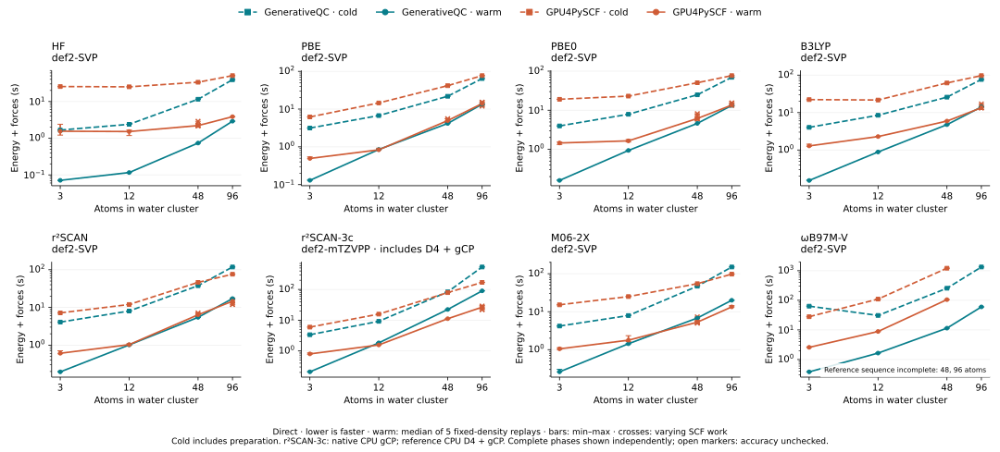
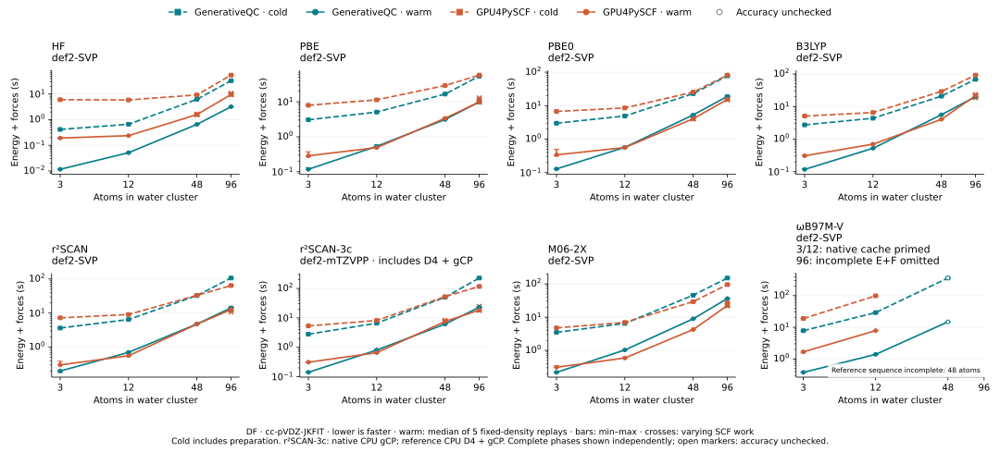

# WB97M-V README refresh from master, started 2026-10-14

This campaign remeasures **GenerativeQC ωB97M-V energy + analytic forces**
from the task-start master snapshot
`810f081ef293256ebe20beb7298f9d21996fec81`, using the ordinary FP64
Release/sm_120 paths. Direct retains all 3, 12, 48 and 96-atom water-cluster
populations; DF retains 3, 12 and 48 atoms. The earlier DF panel stopped at
12 atoms. The new panel includes native DF/48 even without a matching
independent reference. **Only DF/96 is omitted**: no complete E+F call was
obtained, and the user requested cancellation rather than further waiting.





See the [direct](timings.md) and [DF](df-timings.md) tables for complete cold,
warm, moved and moved-warm endpoints and their SCF iteration/Fock-build counts.
Only ωB97M-V is remeasured here. The other seven functionals retain their
individually identified observations from the
[previous campaign](../readme-dft-20261013/README.md); they are not relabeled
as measurements of this master revision. Rebasing the publication onto a newer
master does not change the measured source identity.

## Protocol and accuracy

- RTX 5090 on `n5` (direct) and `n1` (DF), with each native campaign assigned
  its own GPU by finite Slurm allocations; device visibility is preserved.
  Points through 48 atoms retain the 1800-second limit. Direct/96 uses a
  3600-second point limit and a 65-minute allocation to collect all twelve
  endpoints. No stopping tolerance, acceptance gate or repeat count is relaxed.
  Direct runs preload matching CUDA 12.9 libraries to avoid an older cuSOLVER
  without the required batched eigensolver API. Setup-only failures and
  interrupted attempts contribute no published timing samples.
- Spherical def2-SVP, FP64, the unchanged `(48, 16, 32)` moving Becke grid,
  self-consistent VV10 and analytic grid/partition response. DF uses explicit
  cc-pVDZ-JKFIT auxiliaries. Native full-range J/K is fitted, while the
  long-range K correction is exact-direct; only matching references qualify DF.
- Cold includes construction, preparation and the first complete calculation.
  Existing compiler/artifact caches are retained. Warm is the median of all
  five replays from a fixed post-cold density; bars show min–max, and differing
  SCF work is retained rather than normalized away. Each point also retains one
  moved-geometry endpoint and five moved-warm replays.
- The seven native populations contain **84 complete E+F calls**: 72 pass
  independent accuracy gates; 12 (DF/48) remain explicitly unchecked.
  Missing reference data never suppresses a completed native timing.
- Available references retain their independent GPU4PySCF source,
  binary/package identities and sampling dates. Accuracy-only geometry receipts
  do not create reference cold/warm timings. Acceptance is `|ΔE| ≤ 1e-8 Eh`
  and `max |ΔF| ≤ 1e-7 Eh/bohr` for every checked call.
- DF/48 has no matching independent geometry oracle in this campaign. Its
  complete timings use open markers and `‡`; energy/force errors remain null.
  Completion is **not** claimed as an accuracy pass or a reference speedup.
  Historical mismatched fully fitted LR references are not reused.

## Omitted DF/96 and negative evidence

DF/96 with the default 1 GiB force allowance converges SCF but returns status 1
and no host forces: the lazy exact-LR derivative reserve leaves no admitted
stationary grid schedule. This is an execution failure, not a missing reference.
`df96-default-force-probe.json.xz` retains that failed call. Raising only the
device allowance to 4 GiB still fails the independent 2 GiB host envelope
(`df96-device4-host2-probe.json.xz`). Even with both allowances at 4 GiB,
automatic DF workspace selection fails the generated stationary response
(`df96-device4-host4-probe.json.xz`). None is plotted as E+F timing.

`df96-capacity.json` retains native capacity queries and short preparation-only
probes. A metadata-only 1024-point schedule needs 1,981,354,125 device bytes and
2,605,403,181 host bytes. Automatic DF preparation leaves 1,178,271,744 free
device bytes; an explicit 12 GiB workspace hint leaves 8,818,196,480. These
measurements do not establish the ownership of every device allocation and are
not complete endpoint timings or numerical qualification.

A final attempt on `n4` used the existing 12 GiB DF workspace hint, 4 GiB
device/host force allowances and a 2 GiB optional LR resident-value cache
ceiling. It selected the bounded streamed value fallback but produced no
complete cold E+F record before user-requested cancellation on 2026-10-15.
The point is absent from both the timing reduction and the plotted series;
there is no invented timeout, timing, accuracy pass or speedup. No production
default, scientific equation or acceptance gate is changed.

## Retained evidence and replay

`summary.json.xz` and `df-summary.json.xz` contain only refreshed ωB97M-V
populations, including per-call timings/work, residuals, phase status, binary
and consumer hashes, scheduler receipts, independent oracle arrays and
raw-record hashes. Unchanged baseline populations are referenced, not duplicated.
`manifest.json` binds the new files and the two exact baseline reductions.
Full raw native force arrays, logs and build products stay in ignored local
run storage; the scalar audit does not recompute omitted force vectors.

From the repository root, verify retained bytes and complete native phases:

```bash
PYTHONPATH=.:python python benchmarks/results/readme-wb97mv-20261014/refresh.py
```

Replay the tables and figures with the recorded Matplotlib environment and
Scour 0.38.2 (used only to compact generated SVG markup):

```bash
PYTHONPATH=.:python python benchmarks/results/readme-wb97mv-20261014/refresh.py \
  --output .artifacts/readme-wb97mv-replay
```

The repository-wide 64 MiB evidence budget is unchanged. To keep this refresh
within it, the previous campaign's two SVGs are archived as lossless `.svg.xz`
files, with both compressed and original hashes verified by its audit. Every
historical measurement, source identity and original figure byte is retained;
the historical README previews use the existing Git snapshot. New SVGs are
compacted with Scour, while all timing reductions remain unchanged.

For a new measurement, check out the exact recorded source, build the
`cuda-release-sm120` Release configuration with verified compiler-cache
launchers, and select that library. The reproduction script runs only the
seven retained populations, from that source checkout with a fresh output
directory and finite allocation:

```bash
GENERATIVEQC_LIBRARY=/path/to/build/libgenerativeqc.so \
  srun --partition=main --gres=gpu:5090:1 --nodes=1 --ntasks=1 \
  --cpus-per-task=8 --time=04:05:00 \
  bash /path/to/readme-wb97mv-20261014/reproduce.sh .artifacts/wb97mv-new
```

Restore matching `reference.json`, its outcome, and `accuracy-reference-*.json`
beside each native output before independent accuracy replay. Without them,
the benchmark still runs, but its accuracy remains explicitly unchecked.
Reproduction requires the ordinary benchmark dependencies, including GPU4PySCF
for grid/reference setup, even for a native-only campaign.
